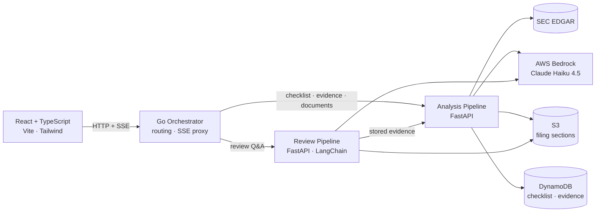

# Snowball

**Snowball reads a public company's SEC filings and answers a checklist of questions about it — with the raw evidence behind every answer.**

Point it at a ticker. It pulls the 10-Ks, 10-Qs, and proxy statements straight from SEC EDGAR, runs a checklist of LLM sub-agents over the specific filing sections you point them at, and returns the evidence they found for each question, year by year, with the quoted source text. There are no scores and no summaries — the evidence is the result. When you want to dig further, you can @-mention a filing section and ask about it in plain English.

---

## What it does

- **Fetches filings from EDGAR** — 10-K, 10-Q, and DEF 14A, split into individual filing sections and cached in S3 so the same document is never pulled twice.
- **Answers an editable checklist** — categories contain questions, and each question has any number of sub-agents, each aimed at one 10-K or 10-Q section. Every sub-agent returns raw evidence per filing across the selected years: what it found, a verbatim snippet, and whether the filing disclosed it at all.
- **Shows its work** — each finding carries a verbatim quote from a specific section of a specific filing. Nothing is paraphrased into a conclusion.
- **Answers follow-up questions** — a LangChain agent that can read any cached filing section, pull the stored checklist evidence, and take sections you @-mention as context.
- **Lets you edit the checklist** — categories, questions, and per-section sub-agent prompts are editable from the UI, versioned, and cache-invalidating.

---

## Quickstart

**Prerequisites:** Docker, AWS credentials in `~/.aws` with Bedrock/S3/DynamoDB access in `us-east-2`, and Node 20+ for the frontend.

```bash
# EDGAR requires an identity string on every request
mkdir -p secrets && cp secrets.example/EDGAR_IDENTITY.txt secrets/
# edit secrets/EDGAR_IDENTITY.txt with your name and email

docker compose up            # orchestrator on :8080, both pipelines behind it

cd frontend
cp .env.example .env
npm install && npm run dev   # UI on :5173, proxying /api -> :8080
```

Infrastructure (S3 bucket, DynamoDB tables, ECR repos, VPC, IAM) is defined in `terraform/` — `terraform apply` from that directory provisions it.

---

## Architecture

Three containers behind a Go orchestrator. Go handles routing and stream proxying where throughput matters; Python handles everything touching an LLM.



**Request path for a checklist run:** the browser opens an SSE stream to the orchestrator, which proxies it to the analysis pipeline. That pipeline fetches each unique filing section once, fans out one Bedrock call per sub-agent per filing, and emits a progress event per completed call — so the UI shows real per-section progress rather than a spinner.

---

## Engineering highlights

**The checklist is data, not code.** Categories, questions, and sub-agents live in DynamoDB. Each sub-agent targets a single filing section (`10-K#part_ii_item_7`) with its own prompt. Question and sub-agent versions are part of the evidence cache key, so editing a prompt invalidates exactly that sub-agent's evidence and leaves every other question's cached work intact. Changing how the system thinks requires no deploy.

<!--  -->

**Prompt caching that accounts for its own cost.** Many sub-agents read the same filing section, so each Bedrock call is split around an explicit `cachePoint`: the section excerpt forms a byte-identical cached prefix, and only the question and sub-agent directions sit past it. The first sub-agent to touch a block writes the cache; the rest read it back. Critically, caching is disabled when only one sub-agent will read a given block — a cache write costs 1.25x normal input tokens, which is pure waste if nothing reads it. Cache hits and writes are logged per block so the behavior is observable in production, not assumed.

**Evidence is the result.** There's no aggregation step: the sub-agents' findings are stored as-is and read back by question, so the UI and the review agent see exactly what was extracted, not a model's summary of it. A run can be scoped to the whole checklist, one category, or one question, and a question can be limited to the latest filing.

**Concurrency with failure isolation.** Bedrock fan-out is capped by a semaphore, and the asyncio thread pool is explicitly resized — the default (`min(32, cpu_count + 4)`) caps a 2-vCPU instance below the worker count, and these threads are all I/O-wait, so the ceiling is artificial. A single sub-agent call failing (unparseable JSON after retries, say) is logged and skipped: that sub-agent ends up with less evidence, instead of the whole run aborting.

**Grounded Q&A over the filings.** The review pipeline gives a LangChain agent two tools: `read_section` for any cached filing section, and `get_evidence` for the stored checklist evidence (fetched from the analysis pipeline, so version filtering isn't duplicated). Sections the user @-mentions are injected in full, and a manifest of what's cached is in the system prompt, so answers come from the actual filing text.

**Streaming end to end.** Progress events originate in the Python run loop, cross the Go orchestrator through a dedicated SSE proxy, and drive a reducer in React. One mechanism, three languages, no polling.

**Infrastructure as code.** Terraform defines the VPC, S3 bucket, five DynamoDB tables, ECR repositories, and IAM roles, with remote state in S3 and lockfile-based locking. Containers are built and pushed to ECR via scripts in `scripts/`, then run on EC2 with `docker-compose.prod.yml` pinned to commit-SHA image tags.

**Kubernetes migration, in progress.** All three services have manifests in `k8s/` — a deployment and service per container, plus ServiceAccounts for the two Python pipelines — running against a local cluster today. The AWS side is written but not yet applied: an EKS module using Auto Mode compute on the VPC's private subnets, and pod-level AWS access granted through **EKS Pod Identity associations** rather than the older IRSA annotation pattern, so the pipelines get scoped Bedrock/S3/DynamoDB permissions without long-lived credentials. What remains is provisioning the cluster and wiring the associations to the ServiceAccounts. Production currently runs on EC2 via Docker Compose — the migration is deliberately staged rather than half-deployed.

---

## Tech stack

| Technology | Where it's used | Why |
| --- | --- | --- |
| **Go** | Orchestrator | Routing and SSE proxying — the hot path that isn't LLM-bound |
| **Python + FastAPI** | Both pipelines | Async I/O fan-out, and where the LLM ecosystem lives |
| **AWS Bedrock** (Claude Haiku 4.5) | Evidence extraction, Q&A | Managed inference with prompt caching and IAM-native auth |
| **LangChain** | Review pipeline | Agent loop with tool calling over filings and evidence |
| **edgartools** | Document retrieval | Section-level parsing of EDGAR HTML filings |
| **DynamoDB** | Checklist, evidence, sessions | Composite-key access patterns; no relational needs |
| **S3** | Filing section cache | Cheap, durable blob storage for re-retrieval avoidance |
| **React 19 + TypeScript** | Frontend | Typed contracts against the API surface |
| **Tailwind** | Styling | Consistency without a parallel CSS codebase |
| **Docker Compose** | Local + prod | Same three containers in both environments |
| **Terraform** | AWS infrastructure | Reproducible provisioning, remote state |
| **Kubernetes** | Manifests written, local cluster | Migration target for the EC2 deployment |

---

## Repo map

```
orchestrator/        Go — HTTP routing, SSE proxying, per-service clients
analysis-pipeline/   Python — EDGAR retrieval, checklist config, evidence extraction
review-pipeline/     Python — LangChain agent for Q&A over filings and evidence
frontend/            React + TypeScript + Tailwind
terraform/           VPC, S3, DynamoDB, ECR, IAM (EKS module written, not applied)
k8s/                 Deployments, services, ServiceAccounts for all three containers
scripts/             ECR login/push, endpoint smoke tests
```
