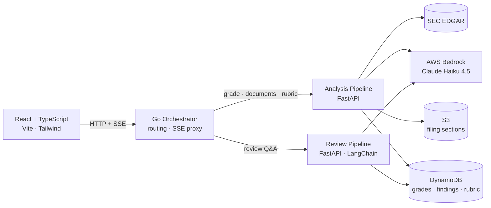

# Snowball

**Snowball reads six years of a public company's SEC filings and grades it across 14 fundamentals categories — then shows you the evidence behind every score.**

Point it at a ticker. It pulls the 10-Ks, 10-Qs, and proxy statements straight from SEC EDGAR, runs a rubric of LLM sub-agents over the specific filing sections that matter for each category, and returns a 0–100 grade with the reasoning and the quoted source text that produced it. When a score looks wrong, you can ask why in plain English and get an answer grounded in the filings — not a fresh guess.

---

## What it does

- **Fetches filings from EDGAR** — 10-K, 10-Q, and DEF 14A, split into individual filing sections and cached in S3 so the same document is never pulled twice.
- **Grades 14 fundamentals categories** — revenue durability, moat/ROIC persistence, earnings quality, balance sheet resilience, capital allocation, and ten more. Each category returns a 0–100 score, written reasoning, and verbatim quotes from the filings.
- **Shows its work** — every score traces back to a specific finding in a specific section of a specific filing. Nothing is asserted without a citation.
- **Answers follow-up questions** — a LangChain agent with retrieval tools over the stored findings, so "why did capital allocation score low?" gets an answer pulled from what was actually read.
- **Lets you edit the rubric** — category directions and per-section sub-agent prompts are editable from the UI, versioned, and cache-invalidating.

---

## Quickstart

**Prerequisites:** Docker, AWS credentials in `~/.aws` with Bedrock/S3/DynamoDB access in `us-east-2`, and Node 20+ for the frontend.

```bash
# EDGAR requires an identity string on every request
mkdir -p secrets && cp secrets.example/EDGAR_IDENTITY.txt secrets/
# edit secrets/EDGAR_IDENTITY.txt with your name and email

docker compose up            # orchestrator on :8080, both pipelines behind it

cd frontend
cp .env.example .env
npm install && npm run dev   # UI on :5173, proxying /api -> :8080
```

Infrastructure (S3 bucket, DynamoDB tables, ECR repos, VPC, IAM) is defined in `terraform/` — `terraform apply` from that directory provisions it.

---

## Architecture

Three containers behind a Go orchestrator. Go handles routing and stream proxying where throughput matters; Python handles everything touching an LLM.



**Request path for a grading run:** the browser opens an SSE stream to the orchestrator, which proxies it to the analysis pipeline. That pipeline fetches each unique filing section once, fans out Bedrock calls across categories, and emits a progress event per completed call — so the UI shows real per-section progress rather than a spinner.

---

## Engineering highlights

**The rubric is data, not code.** All 14 categories live in DynamoDB, each with sub-agent prompts scoped to individual filing sections (`10-K#part_ii_item_7`). Editing a prompt bumps a version, and that version is part of the grade cache key — so an edit invalidates exactly the grades it should and leaves every other category's cached work intact. Changing how the system thinks requires no deploy.


**Prompt caching that accounts for its own cost.** Multiple categories read the same filing section, so each Bedrock call is split around an explicit `cachePoint`: the section excerpt forms a byte-identical cached prefix, and only the category-specific directions sit past it. The first category to touch a block writes the cache; the rest read it back. Critically, caching is disabled when only one category will read a given block — a cache write costs 1.25x normal input tokens, which is pure waste if nothing reads it. Cache hits and writes are logged per block so the behavior is observable in production, not assumed.

**Concurrency with failure isolation.** Bedrock fan-out is capped by a semaphore shared across extraction and aggregation, and the asyncio thread pool is explicitly resized — the default (`min(32, cpu_count + 4)`) caps a 2-vCPU instance below the worker count, and these threads are all I/O-wait, so the ceiling is artificial. A single block or category failing (unparseable JSON after retries, say) is logged and skipped: that category ends up with less evidence, instead of the whole company grade aborting.

**Grounded Q&A instead of re-inference.** The review pipeline gives a LangChain agent two retrieval tools over stored rationales and findings, with a manifest of what's available injected into the system prompt. It answers by fetching what was actually read during grading, so follow-up answers stay consistent with the scores rather than re-deriving them from scratch.

**Streaming end to end.** Progress events originate in the Python grading loop, cross the Go orchestrator through a dedicated SSE proxy, and drive a reducer in React. One mechanism, three languages, no polling.

**Infrastructure as code.** Terraform defines the VPC, S3 bucket, four DynamoDB tables, ECR repositories, and IAM roles, with remote state in S3 and lockfile-based locking. Containers are built and pushed to ECR via scripts in `scripts/`, then run on EC2 with `docker-compose.prod.yml` pinned to commit-SHA image tags. Kubernetes manifests exist in `k8s/` and run against a local cluster — the EKS module is written but currently commented out.

---

## Tech stack

| Technology | Where it's used | Why |
| --- | --- | --- |
| **Go** | Orchestrator | Routing and SSE proxying — the hot path that isn't LLM-bound |
| **Python + FastAPI** | Both pipelines | Async I/O fan-out, and where the LLM ecosystem lives |
| **AWS Bedrock** (Claude Haiku 4.5) | Grading, Q&A | Managed inference with prompt caching and IAM-native auth |
| **LangChain** | Review pipeline | Agent loop with tool calling over stored findings |
| **edgartools** | Document retrieval | Section-level parsing of EDGAR HTML filings |
| **DynamoDB** | Grades, findings, rubric | Composite-key access patterns; no relational needs |
| **S3** | Filing section cache | Cheap, durable blob storage for re-retrieval avoidance |
| **React 19 + TypeScript** | Frontend | Typed contracts against the API surface |
| **Tailwind** | Styling | Consistency without a parallel CSS codebase |
| **Docker Compose** | Local + prod | Same three containers in both environments |
| **Terraform** | AWS infrastructure | Reproducible provisioning, remote state |

---

## Repo map

```
orchestrator/        Go — HTTP routing, SSE proxying, per-service clients
analysis-pipeline/   Python — EDGAR retrieval, rubric grading, scoring
review-pipeline/     Python — LangChain agent for Q&A over results
frontend/            React + TypeScript + Tailwind
terraform/           VPC, S3, DynamoDB, ECR, IAM
k8s/                 Deployment manifests (exploratory)
scripts/             ECR login/push, endpoint smoke tests
```

---

## Status

Working end to end: EDGAR retrieval and caching, all 14 categories grading with streamed progress, rubric editing with versioned cache invalidation, and grounded Q&A over completed analyses. Deployed by pushing images to ECR and running the prod compose file on EC2.

In progress: Kubernetes orchestration (manifests run locally; EKS not yet provisioned).